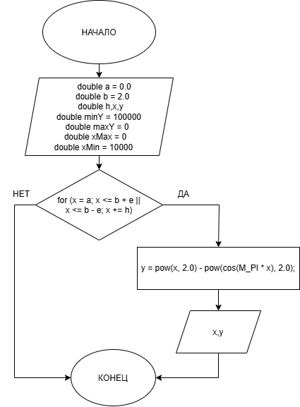

# Домашнее задание к работе 8
## Вариант: 30

## Условие задачи  
Для заданной функции y = f(x) выполнить табулирование на указанном интервале.  
  
Программа должна:  
  
1)запросить шаг h  
2)последовательно изменять x от a до b с шагом h  
3)для каждого x вычислять y = f(x)  
4)выводить результаты в виде таблицы  


## 1. Алгоритм и блок-схема

### Алгоритм
1. **Начало**  
2. Объявить переменные:  
   - `double a = 0.0` - нижняя граница x
   - `double b = 2.0` - верхняя граница x
   - `double h, x, y;` - h - шаг изменения x 
   - `double minY = 100000;`
   - `double maxY = 0;`
   - `double xMin = 10000;`
   - `double xMax = 0;`
   - `double e = 0.000000000001;`
3. Вывести приглашение к вводу: `printf("Введите шаг h: ");`  
4. Ввести величин шага x: `scanf("%lf", &h);`
5. Запустить цикл `for`: `for (x = a; x <= b + e || x <= b - e; x += h)`  
   - `y = pow(x, 2.0) - pow(cos(M_PI * x), 2.0);` - Вычислить y по формуле
   - `printf("   %5.2lf   |  %5.2lf   \n", x, y);` - Вывести результат
6. **Конец**
 

### Блок-схема
  

---

## 2. Реализация программы

```C++
#include<stdio.h>
#include<locale.h>
#include<math.h>
#define M_PI 3.14
int main()
{
	setlocale(LC_CTYPE, "UTF-8");

	double a = 0.0;
	double b = 2.0;
	double h, x, y;
	double minY = 100000;
	double maxY = 0;
	double xMin = 10000;
	double xMax = 0;
	double e = 0.000000000001;

	printf("Введите шаг h: ");
	scanf("%lf", &h);
	printf("     x     |     y       \n");
	printf("------------------------\n");

	for (x = a; x <= b + e || x <= b - e; x += h)
	{
		y = pow(x, 2.0) - pow(cos(M_PI * x), 2.0);
		printf("   %5.2lf   |  %5.2lf   \n", x, y);

	}


}
```
## 3. Результаты работы программы  
  
  
> Введите шаг h: 0.1  
>    x   |   y    
> -------|--------  
> 0.00   |  -1.00  
> 0.10   |  -0.89  
> 0.20   |  -0.61  
> 0.30   |  -0.26  
> 0.40   |   0.06  
> 0.50   |   0.25  
> 0.60   |   0.27  
> 0.70   |   0.15  
> 0.80   |  -0.01  
> 0.90   |  -0.09  
> 1.00   |   0.00  
> 1.10   |   0.30  
> 1.20   |   0.78  
> 1.30   |   1.34  
> 1.40   |   1.86  
> 1.50   |   2.25  
> 1.60   |   2.47  
> 1.70   |   2.55  
> 1.80   |   2.59  
> 1.90   |   2.71  
> 2.00   |   3.00  
## 4. Информация о разработчике
### Чудакова Екатерина бИЦТ-261
